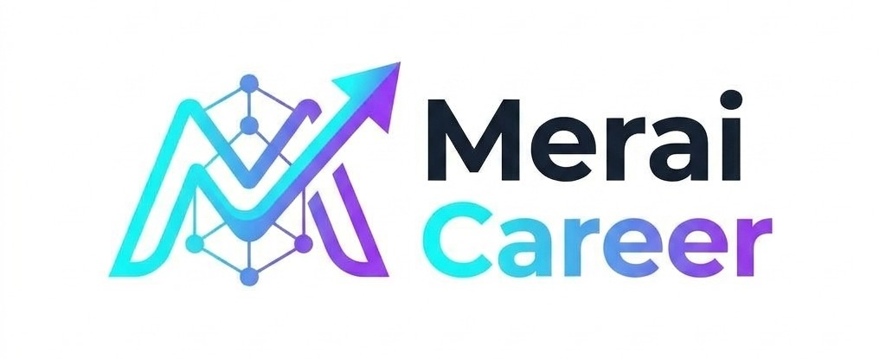
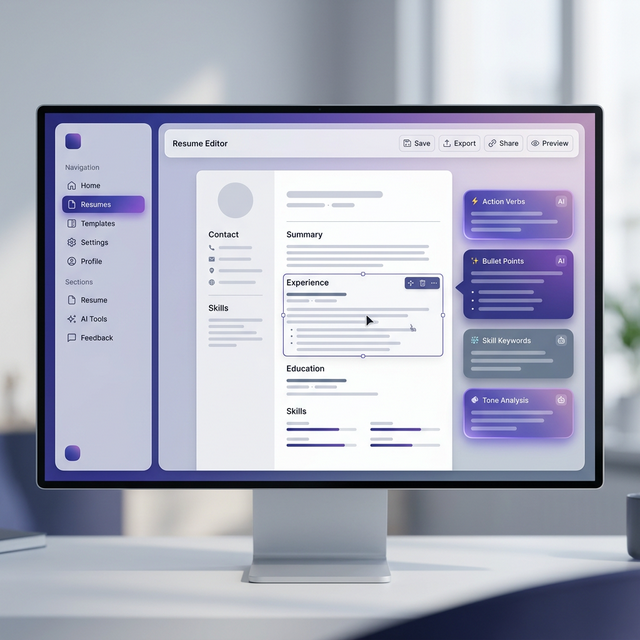
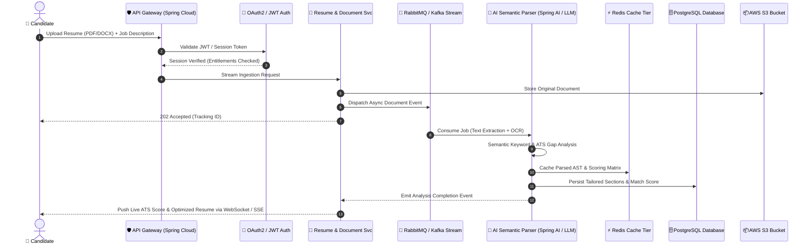
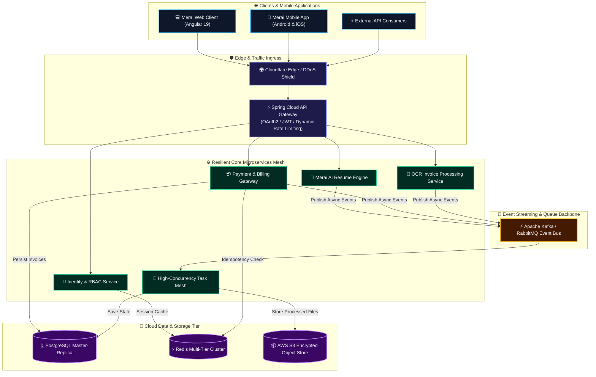
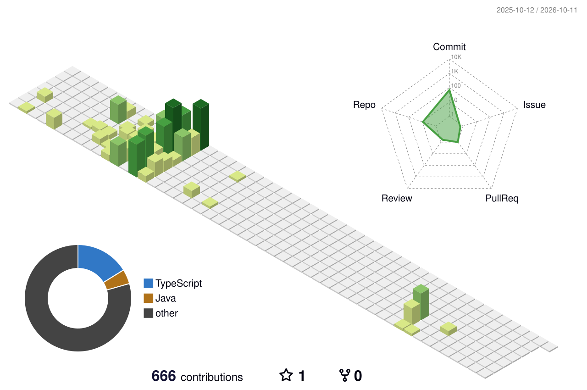

  <!-- Futuristic Cyberwave Animated Header Banner -->
  

   

  <!-- Dynamic Typing SVG Banner -->
  

    

  <!-- Vivid Social & Product Badges -->
  

    
    
    
    
    
  

  <!-- Glowing Metrics Badges -->
  

    
    
    
    
  

---

### 💫 About Me

  <table>
    <tr>
      <td width="30%" align="center" valign="middle">
        
          
        
      </td>
      <td width="70%" valign="middle">
        <h3>🚀 Mohana Sai Kumar Rongala</h3>
        
<b>Founder & Chief Architect</b> at <a href="https://usemerai.com"><b>Merai Career (usemerai.com)</b></a>

        
Passionate about crafting ultra-low-latency distributed systems, reactive microservices, and AI-driven document intelligence at scale.

        

          
          
          
          
          
          
          
          
        

      </td>
    </tr>
  </table>

---

## 🌟 Flagship Ecosystem: [Merai Career (usemerai.com)](https://usemerai.com)

  
    
  
  

    
    
    
  

**[Merai Career (usemerai.com)](https://usemerai.com)** is an AI-powered Career Studio & ATS Resume Tailoring ecosystem designed for job seekers globally:

* 🎯 **AI ATS Resume Tailor & Optimizer**: Analyzes complex Job Descriptions and matches candidates' resumes with real-time semantic keyword gap scoring, action-verb boosts, and format verification.
* ⚡ **Live Interactive Resume Studio**: Real-time multi-template resume customization with instant PDF rendering, QR code credentials, and custom typography presets.
* 🤖 **Multi-Model AI Intelligence**: Intelligent AI Cover Letter Generator, interview coaching simulators, career path advisors, and automated resume translation.
* 📱 **True Omnichannel Delivery**: Web app running in synergy with native Android & iOS mobile applications orchestrated through high-performance Spring Boot REST APIs.
* 💳 **Global Billing & Subscriptions**: Integrated Razorpay & Stripe multi-currency checkout pipelines with automated invoice generation, webhooks, and instant entitlement provisioning.

---

### 📊 End-to-End Merai Career AI Engine Workflow

The following diagram illustrates how **Merai Career** processes candidate resumes and job descriptions through an asynchronous AI semantic pipeline:

---

## ⚡ Featured Engineering Systems & Technical Portfolio

| Product / Innovation | Core Architecture | Impact & Technical Highlights |
| :--- | :--- | :--- |
| **[Merai Career](https://usemerai.com)** | Java 21, Spring Boot 3, Angular 19, Spring AI, AWS | Full-scale autonomous career platform with sub-second ATS parsing, automated PDF rendering, and multi-tenant subscriptions. |
| **Enterprise OCR Invoice Processing Engine** | Java, Spring Boot, OpenCV/Tesseract, Redis | Automated enterprise financial document pipeline parsing invoices with 99.4% precision; cuts manual reconciliation overhead by 80%. |
| **Mission-Critical Payment & Checkout Gateway** | Spring Cloud, Redis Distributed Locks, Kafka | High-resilience transactional pipeline with distributed idempotency, zero double-spending, webhooks verification & automated failure reconciliation. |
| **High-Throughput Asynchronous Worker Pipeline** | Spring WebFlux, RabbitMQ, Docker, PostgreSQL | Asynchronous distributed worker mesh processing heavy media conversions, compression, and structured PDF generation at high concurrency. |
| **Gemini AI Watermark Eliminator Engine** | Reverse Alpha Blending, Modern Canvas, TS/JS | Mathematically precise reverse alpha decomposition algorithm removing watermarks client-side with 0% cloud compute latency. |

---

### 💼 Enterprise Distributed Systems Engineering

In high-concurrency production backend environments, I architect enterprise-grade transactional pipelines and distributed services:

- 🛡️ **Distributed Lock & Idempotent Transactions**: Implemented Redis Redlock distributed synchronization across payment flows, preventing concurrency collisions and race-condition double debits.
- 🧾 **Intelligent Document Ingestion**: Architected multi-threaded document intake pipelines processing high-volume corporate invoices into double-entry accounting ledgers.
- ⚡ **Resilience & Fault Isolation**: Configured Resilience4j circuit breakers, rate limiters, and self-healing fallback mechanisms across all downstream external microservices.

---

### 🛠️ Distributed Cloud & Microservices Topology

---

### 💻 Technology Ecosystem

| Domain | Technologies & Frameworks |
| :--- | :--- |
| **Backend & Core** |  |
| **Cloud & DevOps** |  |
| **Data & Caching** |  |
| **Frontend & UI** |  |
| **Observability & Tools** |  |

---

### 📐 Engineering Principles & Architectural Patterns

- **Clean Architecture & Domain-Driven Design (DDD)**: Clear boundary segregation separating business rules, domain entities, and data access adapters.
- **CQRS & Event Sourcing**: Separating high-frequency queries through Redis caches and materializing write models safely on transactional databases.
- **Transactional Outbox Pattern**: Guaranteeing atomic dual-writes across PostgreSQL and message brokers without two-phase commit locks.
- **Zero-Downtime Deployment**: Blue-Green and Canary orchestration with rolling health probes and database migration isolation (Flyway / Liquibase).

---

### 📊 GitHub Activity & Real-Time Performance Analytics

  <table border="0" cellspacing="0" cellpadding="0">
    <tr>
      <td align="center" width="50%">
        
      </td>
      <td align="center" width="50%">
        
      </td>
    </tr>
  </table>

   

  

    

  <h3>🔥 3D Interactive Contribution Space</h3>
  

    

  <h3>🐍 Contribution Snake Quest</h3>
  

---

  
  
🚀 <b>Founder of <a href="https://usemerai.com">Merai Career</a> • Engineering resilient distributed software with passion & precision</b>

