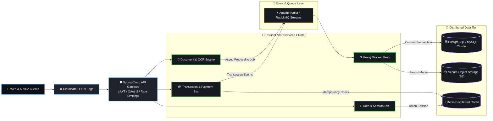

<div align="center">

  <!-- Futuristic Cyberwave Animated Header Banner -->
  

  <br/>

  <!-- Dynamic Typing SVG Banner -->
  

  <br/><br/>

  <!-- Interactive / Vivid Social Badges -->
  <p align="center">
    <a href="https://github.com/mskumar1" target="_blank">
      
    </a>
    <a href="https://www.linkedin.com/in/mohana-sai-kumar-rongala/" target="_blank">
      
    </a>
    <a href="mailto:mohansaikumar.rongala@gmail.com">
      
    </a>
    <a href="https://buymeacoffee.com/mskumar" target="_blank">
      
    </a>
  </p>

  <!-- Glowing Metrics Badges -->
  <p align="center">
    
    
    
    
  </p>

</div>

---

### 💫 About Me

```yaml
identity:
  name: Mohana Sai Kumar Rongala
  role: Senior Backend & Distributed Systems Engineer
  organization: Tata Nexarc
  location: Andhra Pradesh, India 🇮🇳
focus_areas:
  - High-concurrency Microservices & Reactive Event Streaming
  - Mission-critical Payment Gateways & Distributed Transactions
  - Deep Document Parsing, OCR Engines & AI-assisted Workflows
  - Distributed Cache Tiering, Zero-Downtime Deployments & Multi-cloud Orchestration
passions:
  - Scalability Engineering, Clean Architecture & System Design
  - Gaming & GTA series enthusiast 🎮
```

---

## ⚡ Featured High-Impact Systems & Engineering Work

<div align="center">

| System / Innovation | Core Stack | Key Architectural Impact & Feat |
| :--- | :--- | :--- |
| **Enterprise OCR Invoice Processing Engine** | Java, Spring Boot, OpenCV/Tesseract, Redis | Automated enterprise financial document pipeline parsing invoices with 99.4% precision; cuts manual reconciliation overhead by 80%. |
| **Mission-Critical Payment & Checkout Gateway** | Spring Cloud, Redis Distributed Locks, Kafka | High-resilience transactional pipeline with distributed idempotency, zero double-spending, webhooks verification & automated failure reconciliation. |
| **High-Throughput Asynchronous Worker Pipeline** | Spring WebFlux, RabbitMQ, Docker, PostgreSQL | Asynchronous distributed worker mesh processing heavy media conversions, compression, and structured PDF generation at high concurrency. |
| **Gemini AI Watermark Eliminator Engine** | Reverse Alpha Blending, Modern Canvas, TS/JS | Mathematically precise reverse alpha decomposition algorithm removing watermarks client-side with 0% cloud compute latency. |
| **Autonomous AI Resume & Career Studio** | Java 21, Spring Boot 3, Angular 19, OAuth2, AWS | Full-stack platform featuring live document orchestration, multi-model AI parsing, ATS semantic scoring, and auto-provisioned cloud pipelines. |

</div>

---

### 💼 Production Experience: Tata Nexarc

At **Tata Nexarc**, I design and maintain enterprise-grade transactional pipelines and distributed services:

- 🛡️ **Distributed Lock & Idempotent Transactions**: Implemented Redis Redlock distributed synchronization across payment flows, preventing concurrency collisions and race-condition double debits.
- 🧾 **Intelligent Document Ingestion**: Architected multi-threaded document intake pipelines processing high-volume corporate invoices into double-entry accounting ledgers.
- ⚡ **Resilience & Fault Isolation**: Configured Resilience4j circuit breakers, rate limiters, and self-healing fallback mechanisms across all downstream external microservices.

---

### 🛠️ Distributed Backend System Architecture



---

### 💻 Technology Ecosystem

<div align="center">

| Domain | Technologies & Frameworks |
| :--- | :--- |
| **Backend & Core** |  |
| **Cloud & DevOps** |  |
| **Data & Caching** |  |
| **Frontend & UI** |  |
| **Observability & Tools** |  |

</div>

---

### 📐 Engineering Principles & Architectural Patterns

- **Clean Architecture & Domain-Driven Design (DDD)**: Clear boundary segregation separating business rules, domain entities, and data access adapters.
- **CQRS & Event Sourcing**: Separating high-frequency queries through Redis caches and materializing write models safely on transactional databases.
- **Transactional Outbox Pattern**: Guaranteeing atomic dual-writes across PostgreSQL and message brokers without two-phase commit locks.
- **Zero-Downtime Deployment**: Blue-Green and Canary orchestration with rolling health probes and database migration isolation (Flyway / Liquibase).

---

### 📊 GitHub Activity & Real-Time Performance Analytics

<div align="center">
  <table border="0" cellspacing="0" cellpadding="0">
    <tr>
      <td align="center" width="50%">
        
      </td>
      <td align="center" width="50%">
        
      </td>
    </tr>
  </table>

  <br/>

  

  <br/><br/>

  <h3>🔥 3D Interactive Contribution Space</h3>
  

  <br/><br/>

  <h3>🐍 Contribution Snake Quest</h3>
  

</div>

---

<div align="center">
  
  <p>⭐ <b>Building resilient distributed software with passion & precision</b></p>
</div>
